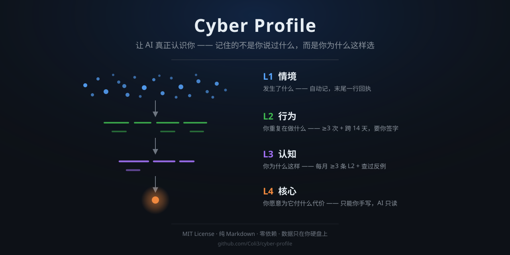

<div align="center">

# Cyber Profile

### 让 AI 真正认识你 —— 记住的不是你说过什么，而是你为什么这样选

**纯 Markdown，存在你自己硬盘上。** Obsidian 能读，Codex / WorkBuddy / Claude Code 能写。

*Local-first personal AI memory in plain Markdown.*

[](https://obsidian.md)
[](#)
[](https://openai.com/codex)
[](#)
[](#)

**[从这里开始 →](00%20从这里开始.md)** ｜ **[搭建规格](01%20搭建规格.md)** ｜ **[首次对话模板](02%20第一次对话模板.md)** ｜ **[示例档案](examples/me.example.md)**



<sub>v1.0.0 · 目录结构、文件清单与十九个命令已冻结，此后只在兼容前提下演进</sub>

</div>

---

> **Obsidian 是 IDE，Agent 是程序员，档案是代码库。**
> 只不过这份代码库编译的不是项目，是你。

---

> **30 秒判断要不要往下读**
> ① 你在用 Obsidian 或纯文本笔记 ｜ ② 你每天都在和 AI 聊天 ｜ ③ 你希望它记住的是"你为什么这样选"，而不只是"你在哪家公司"。
> **三条满足两条，这套东西就是给你做的。**

---

## 一、先看它到底在干什么

大多数人用 AI 存记忆，方式是**攒聊天记录**。攒了三年，AI 依然不认识你——它只是能检索到你说过的话。

Cyber Profile 走另一条路：**在信息进来的那一刻就编译。** 你说的每一句"我决定 X，因为 Y"，会被归进档案的一个字段，标上证据等级、日期、置信度，然后等待被验证、被纠正、被衰减。

```
随口一句  ──→  L1 情境：发生了什么（自动记，一行回执）
                    ↓  每周归堆，≥3 次重复 + 跨 14 天
              L2 行为：你重复在做什么（要你签字）
                    ↓  每月，≥3 条 L2 + 查过反例
              L3 认知：你为什么这样（要你签字）
                    ↓  每季，只能由你手写
              L4 核心：你愿意为它付什么代价（AI 只读）
```

三个月后，你打开 Obsidian 图谱，看到的不是一堆零散笔记，而是一个**正在收敛的结构**。

---

## 二、从卡帕西的 LLM Wiki 往前走一层

这套东西的骨架不是凭空长出来的。它直接沿用 **[Andrej Karpathy 的 LLM Wiki 模式](https://gist.github.com/karpathy/442a6bf555914893e9891c11519de94f)**：三个文件（宪法 / 目录 / 流水账）+ 两层目录（不可变的 raw、LLM 独占写入的 wiki）+ 三个动作（摄入 / 查询 / 体检）。

那套东西解决的是**"我怎么管理我知道的世界"**。

而人还有一个更麻烦的问题：**"我是谁"**。

于是这里在它之上，竖着插进了新的一层：

| | 卡帕西的 LLM Wiki | Cyber Profile |
|---|---|---|
| **宪法** | `CLAUDE.md` | `AGENTS.md` + 托管块（跨工具通用） |
| **索引** | `index.md` / `log.md` | `目录 index.md` / `日志 log.md` |
| **不可变层** | `sources/` 原始素材 | `原始资料 raw/`（不改不删） |
| **编译层** | `wiki/` 关于世界的知识 | `知识库 wiki/` **＋ `档案 profile/` 关于你的知识** |
| **三个动作** | ingest / query / lint | 摄入 / 查档案 / 体检 |
| **冲突处理** | 标出来 | 标出来，**并且要求你裁决** |
| **演化方向** | 越加越密 | 越用越准，**也会衰减、会被证伪** |

一句话：**卡帕西让 AI 维护它对你所知世界的理解；这套东西让 AI 维护它对你的理解。**

而"你"比"世界"难得多——关于你的每一条结论都无法由原文直接验证。所以多出来的部分全是**防自欺机制**：证据分级、签字升级、命中率复盘、美化检测。

---

## 三、三层消费：为什么不该把档案全塞进上下文

最反直觉的一处设计。档案写得越全，AI 反而越抓不住重点。

| 层 | 读什么 | 何时读 | 预算 |
|---|---|---|---|
| **常驻** | `me.md` + `当前 current.md` | 每次会话开场，必读 | ≤400 token |
| **按需** | `L2` / `L3` / `声音` / `框架` | 问题相关时才读 | 单页 ≤300 |
| **证据** | `L1` / `原始资料 raw/` | 只在核实时读 | 不限 |

接线（把 `me.md` 挂进 `AGENTS.md` 的托管块）就是让这三层生效的开关。**不做这步，档案躺在硬盘上，AI 一次也读不到**——那不是"懂你"，那是"家里有本书"。

---

## 四、三步开始

先看一眼包里有什么：

```
Cyberprofile-init/
├── 00 从这里开始.md            三分钟读完的入口（比这页更完整）
├── 01 搭建规格.md              施工图，整份喂给 AI，不要节选
├── 02 第一次对话模板.md         12 段可直接复制的提示词
├── 03 技能包/self-distill/     可选。装上才有自动捕获与蒸馏
├── examples/me.example.md     填好的档案长什么样（虚构人物）
├── docs/设计与借鉴说明.md       每个设计决策的理由，含反悔记录
├── tools/verify.py            搭完跑一遍：4 项硬检查
├── LICENSE · README.md · .gitignore
```

**① 建一个空文件夹**

随便哪儿都行，名字随意。**必须是空的。**

**② 把 [01 搭建规格.md](01%20搭建规格.md) 整份发给 AI**

> 按这份规格，在我的空文件夹里搭建整个项目。文件夹名、文件名一字不改。

能读写文件的（Codex / WorkBuddy / Claude Code / Cursor）自己建文件；只能聊天的（网页版 GPT / Claude / Gemini）让它输出每个文件的内容，你复制粘贴保存。

**③ 让它自检**

> 按规格第四节的 7 条自检，逐条核对，把结果告诉我。

数不对就是没搭完 —— **20 个 md 文件、16 个子目录**。

懒得数的话，跑脚本（需要 Python 3.8+，零依赖）：

```bash
python tools/verify.py "你的档案库路径"
```

它查四件事：20 个文件齐不齐、16 个目录齐不齐、`AGENTS.md` 有没有超 8000 字符、双链有没有断。**退出码 0 就是通过。**

> 它不会判断"你填了多少"——那得靠你自己看。

搭完之后，用 [`02 第一次对话模板.md`](02%20第一次对话模板.md) 里的提示词走第一次建档，然后说一句 **「接线」**。

想先看看成品长什么样，翻 [`examples/me.example.md`](examples/me.example.md)——一个虚构供应链主管的 `me.md`，能看出证据等级、口径、避用词都怎么写。

---

## 五、装不装技能包，差在哪

`03 技能包/self-distill/` 是可选件。复制到 `~/.workbuddy/skills/` 或 `<vault>/.claude/skills/` 即可。

| | 只发规格 | 装了技能包 |
|---|---|---|
| 建库 | ✅ | ✅ |
| 聊天里自动捕获 | ❌ 要手动喊"记一下" | ✅ 它自己拣五类信号 |
| 周 / 月 / 季蒸馏 | ❌ 你自己来 | ✅ 完整流程 + 候选表 |
| 纠正与回滚 | ❌ 手动 | ✅ 秒级纠正 + 快照 |
| 体检（查矛盾、查废话、查美化） | ❌ | ✅ 每两周一次 |
| 升级迁移 | ❌ | ✅ `升级` 命令，改过的出 `.new` |

**送人用前者，自己长期用装后者。**

### 装在哪：Codex 与 WorkBuddy

两个宿主都用 Agent Skills 标准（`SKILL.md`），**同一份技能包放两处即可，不需要改内容。**

```powershell
# WorkBuddy
Copy-Item -Recurse "03 技能包\self-distill" "$env:USERPROFILE\.workbuddy\skills\"

# Codex（启动时自动发现）
New-Item -ItemType Directory -Force "$env:USERPROFILE\.codex\skills" | Out-Null
Copy-Item -Recurse "03 技能包\self-distill" "$env:USERPROFILE\.codex\skills\"
```

```bash
# macOS / Linux
cp -r "03 技能包/self-distill" ~/.workbuddy/skills/
mkdir -p ~/.codex/skills && cp -r "03 技能包/self-distill" ~/.codex/skills/
```

| | Codex | WorkBuddy |
|---|---|---|
| 全局指令 | `~/.codex/AGENTS.md` | `~/.workbuddy/AGENTS.md`（若存在） |
| 项目指令 | `<vault>/AGENTS.md` | `<vault>/AGENTS.md` |
| 技能目录 | `~/.codex/skills/<name>/SKILL.md` | `~/.workbuddy/skills/<name>/SKILL.md` |
| 技能调用 | `$self-distill`，或 `/skills` 列出 | 按 description 自动匹配 |

> ⚠️ **Codex 的全局路径是 `~/.codex/AGENTS.md`，不是 `~/.agents/AGENTS.md`**，写错不会报错，只会静默失效。
>
> 还有一处差异：WorkBuddy 会把 `@绝对路径` 直接展开成文件内容，Codex 不保证展开（它把 AGENTS.md 当纯文本注入）。所以接线块里写了兜底指令——若 `@` 没生效，让 Agent 主动用读文件工具打开那个路径。两种宿主共用同一块文本。

---

## 六、它每天在你旁边做什么

| 频率 | 你说什么 | 它做什么 |
|---|---|---|
| 每天 | 随便聊 | **自动记 L1**，末尾一行回执，可撤销 |
| 随时 | 它主动问 | 一次会话最多 1 个问题，跳过就 7 天不问同类 |
| 随时 | 「纠正」 | 秒级改，改前自动快照 |
| 每周 | 「周蒸馏」 | L1 归堆找模式，**给你候选表，你点头才写** |
| 每月 | 「月蒸馏」 | 升级 L3、算衰减、复盘命中率 |
| 每季 | 「季蒸馏」 | 最多 2 条 L4 候选（**你手抄**）+ 重生成产出面 |
| 每两周 | 「体检」 | 查矛盾、废话、编造、孤页 |

**它只记五类**：决策+理由 / 情绪+触发点 / 明确偏好 / 鲜明立场 / 本想 X 做了 Y。

**它不问的场合**：你在赶时间、你在解决具体问题、你情绪低落（这时只陪不问）。

---

## 七、凭什么可信

**证据分级，行为 > 口述**

| 等级 | 是什么 | 基线 |
|---|---|---|
| T1 | 花了钱 / 时间 / 机会成本的重复行为 | 0.85 |
| T2 | 真实决策 + 给出的理由 | 0.78 |
| T3 | 反复自述且一致（≥3 次，跨 ≥2 周） | 0.72 |
| T4 | 单次明确自述（**含简历**） | 0.60 |
| T5 | 情绪强度反应（不能单独成页） | 0.50 |
| T6 | 顺口提及 / 假设句 / 转述 | 0.30 |
| T7 | AI 推断（必须标注） | ≤0.25 |

**五道锁，防止变成"AI 写的另一个你"**

1. **升级要签字** —— L2 需 ≥3 次 + 跨 ≥14 天 + ≥1 次真实决策；L4 只有你能写
2. **简历不产结论** —— 简历里的一切标 `待核`，等真实行为来认领
3. **冲突不化解** —— "你既想稳定又想突破"不是 bug，两边都留，等你裁决
4. **会衰减，也能回滚** —— 半年无证据自动降级休眠，但**永不删除**；每次写入前快照
5. **有事后验证** —— `L2`/`L3` 带 `命中`/`落空` 计数。哪类判断命中率系统性偏低，就是你最不了解自己的地方

---

## 八、隐私：不是加密保存，是根本不写

每条记录都带**密级**，拿不准按高一级处理：

| 级别 | 范围 | 去向 |
|---|---|---|
| `O` | 兴趣、工作方式、思维偏好 | 可进说明书、声音、分身 |
| `P` | 具体项目、人际细节、职业焦虑 | 只进档案 |
| `R` | 健康、财务、家庭冲突、创伤 | 只留 `原始资料 raw/私密/`，不读不引不索引 |

**绝不入档**：身份证号、银行卡、密码、住址门牌、他人联系方式。

纯 Markdown 存在你自己硬盘上，Obsidian 能打开，任何编辑器都能读。**没有账号、没有云端、没有插件依赖。**

---

## 九、常见问题

**会不会变成 AI 编出来的"另一个我"？**
三道锁：L4 只读（AI 只递候选）、升级必须你签字、体检有"美化检测"（专找"任何人都适用"的废话）。

**只用 Obsidian 不用 AI 行不行？**
能读写，但不会有蒸馏、衰减、证伪——那就退化成普通笔记库了。

**多久才有用？**
第 1 个月基本没用（档案还空）。第 3 个月会出现第一次"这条我不同意"——那是系统开始工作的信号。第 6 个月，那份「沟通说明书」可以直接贴给任何 AI 当系统提示词。

**换电脑 / 换 AI 工具会丢吗？**
不会。全是 Markdown，路径在接线块里。换工具只需重跑一次「接线」。

**为什么不用 RAG / 向量库？**
因为知识应该在**摄入时**编译，而不是在**查询时**重新推导。一个文件夹 + 一个会读文件的 Agent 就够了，不需要数据库。

---

## 十、诚实边界

- 这套东西**不会自动变准**。它只在被你使用、被你纠正的时候变准。
- **张力数为 0 是警报，不是成绩。** 真人的档案里一定有互相拉扯的东西。
- 它记录的是"被记录下来的你"，不是你。**没写进去的部分，才是更大的那部分。**
- 骨架今晚就能好；"你"要靠往后每一次"记一下"和"这不对"慢慢长出来。

---

## 参考与致谢

- **[Karpathy · LLM Wiki](https://gist.github.com/karpathy/442a6bf555914893e9891c11519de94f)** —— 三层结构、宪法/索引/流水账、摄入即编译。整套骨架的起点
- **[setup-my-iq](https://github.com/github/awesome-copilot)** —— 指针接线、托管块、四态检测、一次一问
- **[experience-as-skill](https://github.com/polarpoint-io/experience-as-skill)** —— 抽结构不抽传记、命名框架六要素、token 预算
- **[yourself-skill](https://github.com/notdog1998/yourself-skill)** —— 秒级纠正、版本回滚、人格五层

---

**如果这套东西对你有用，star 一下。** GitHub 的搜索不看你写得多好，只看有没有人标记过——那往往是别人找到它的唯一入口。

[MIT](LICENSE) · 用 Markdown 写的东西，应该能一直读下去。
